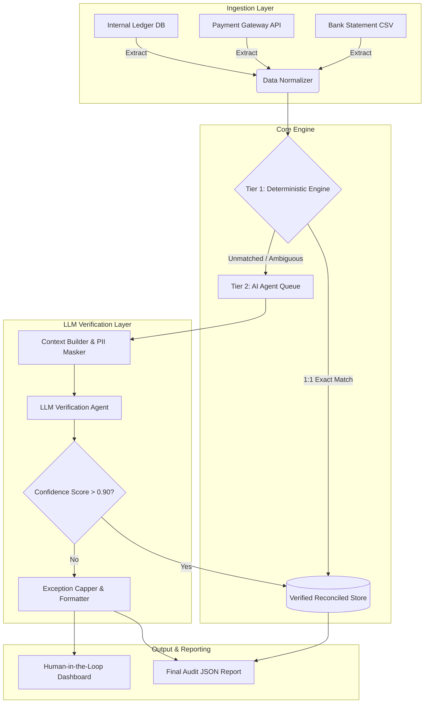

Here is the production-grade Project Master Document (PMD) for the AI Finance Controller system, tailored to solve the complex reconciliation requirements outlined in your Buildathon context.

---

# Project Master Document: AI Finance Controller (Project Aegis)

## 1. Document Control & Metadata

| Attribute | Value |
| --- | --- |
| **Document Title** | AI Finance Controller (Project Aegis) – Reconciliation Engine |
| **Version** | 1.0.0 |
| **Date** | September 25, 2026 |
| **Project Status** | Active Development (Buildathon Submission Phase) |
| **Confidentiality Level** | Internal / Restricted |
| **Primary Authors** | Enterprise Systems Architecture Team |
| **Target Infrastructure** | AWS ECS / Serverless |

---

## 2. Executive Summary & Core Identity

**Executive Summary**
Project Aegis is an AI-augmented reconciliation controller designed to close the finance-operations loop. It ingests multi-source financial data (Internal Ledgers, Payment Gateway Settlements, and Bank Statements), performs high-speed deterministic matching, and routes ambiguous edge cases to a strictly bounded LLM-based verification agent. The system produces a mathematically verified match report alongside an "honest exception list," prioritizing financial accuracy and verification capacity over pure generation.

**30-Second Elevator Pitch**
"We are automating the most painful part of FinOps: reconciliation. Aegis processes tens of thousands of financial records using fast, deterministic rules for the 90% of clean data, and deploys a bounded AI agent to resolve the remaining 10% of fuzzy edge cases—like date misalignments, UTR truncations, and partial refunds. It delivers audited accuracy, strict exception capping, and massive operational cost savings."

**Motivation & Origin Story**
Originating from the Track 04 AI Finance Controller mandate, this project addresses the reality that traditional reconciliation systems fail when confronted with unstructured or semi-structured anomalies (e.g., banking UTR codes appended with random alphanumeric strings). The bottleneck in modern commerce is not generating transactions, but verifying them.

---

## 3. Problem Statement & User Landscape

**Core Problem**
Financial reconciliation currently relies on strict exact-match database queries. When a payment gateway settles a T+2 batch payment minus dynamic tax withholdings, or a bank statement truncates reference IDs, the deterministic systems fail. This creates a massive manual backlog of "unmatched" exceptions requiring human investigation.

**Root Cause Analysis**

1. **Data Fragmentation:** Gateways, banks, and internal databases use varying schema standards.
2. **Asynchronous Settlements:** T+n settlement cycles create date-boundary mismatches.
3. **String Mutation:** Bank UTRs and narrative fields often append/truncate critical identifiers.
4. **Rigid Legacy Rules:** Rule engines cannot interpret context (e.g., realizing two transactions sum up to a single batched settlement).

**User Personas**

* **Primary Persona:** *Finance Ops Analyst* – Needs to review exceptions rapidly rather than manually verifying every row.
* **Secondary Persona:** *System Administrator* – Needs to configure LLM bounds, API limits, and monitor pipeline health.
* **Beneficiary Persona:** *Chief Financial Officer (CFO)* – Requires an accurate, real-time view of realized vs. pending revenue.

---

## 4. Proposed Solution & Value Proposition

**Solution Overview**
Aegis employs a two-tier verification architecture. Tier 1 is a deterministic Python rules engine (matching IDs, amounts, and T+0 dates). Tier 2 is an LLM Agent (acting purely defensively as a verifier) that analyzes the unmatched pool. The LLM identifies semantic linkages (e.g., partial string matches, T+2 date shifts, fee deductions) and proposes matches with confidence scores. The system outputs a strictly capped exception list to prevent alert fatigue.

**Core Value Proposition**
*Deterministic speed for the standard cases, AI comprehension for the edge cases, and mathematical certainty for the final report.*

**Measurable OKRs**

* **OKR 1 (Accuracy):** Achieve a >95% automated match rate across a 50+ record highly-corrupted synthetic dataset without false positives.
* **OKR 2 (Cost Control):** Keep Tier 2 LLM inference costs strictly below $0.005 per processed transaction by aggressively filtering via Tier 1.
* **OKR 3 (Operational SLA):** Reduce the human-in-the-loop exception review queue by 80% compared to baseline manual operations.

---

## 5. Quantitative Analysis, ROI & Business Impact

**Baseline vs. Post-Implementation Metrics**

| Metric | Current State (Manual/Legacy) | Target State (Aegis) |
| --- | --- | --- |
| **Match Rate (Automated)** | 60% | >95% |
| **Time per Exception Review** | 4.5 minutes | < 30 seconds |
| **Cost per 1,000 Txns** | $85.00 (Labor) | $2.50 (Compute + LLM API) |
| **Reconciliation SLA** | T+4 Days | T+1 Hour |

**Cost-Benefit Analysis (CBA)**
Deploying LLMs purely for verification (not generation) ensures bounded costs. If 10,000 transactions flow daily, and 2,000 hit the LLM (at $0.001 per prompt context), daily API cost is $2.00, replacing approximately 150 hours of manual FinOps labor per week.

**Scalability Projections**
The Tier 1 deterministic engine scales linearly via Kubernetes pods (up to 10k TPS). Tier 2 (LLM) scales horizontally but is rate-limited by vendor API quotas; thus, the architecture implements asynchronous dead-letter queues and backoff retries.

---

## 6. System & Technical Architecture

**System Component Flow (Mermaid TD)**



**Non-Functional Requirements (NFRs)**

* **Latency:** Tier 1 < 10ms per row. Tier 2 < 2.5s per resolution.
* **Security:** PII masking (names, account numbers) applied *before* data hits the external LLM boundary.
* **Availability:** 99.9% uptime with fallback to Tier-1-only mode if the LLM provider experiences an outage.

---

## 7. Exhaustive Tech Stack Matrix

| Stack Layer | Tool / Technology | Specific Usage / Location | Why Chosen | Alternatives Evaluated |
| --- | --- | --- | --- | --- |
| **Language** | Python 3.13 | Core backend processing | Superior data/AI ecosystem, native type hinting. | Go, Rust (Lacks rich AI ecosystem) |
| **Framework** | FastAPI | API endpoints & lifecycle | Async native, auto-generates OpenAPI docs. | Flask, Django (Too heavy/slow) |
| **Data Validation** | Pydantic V2 | Schema enforcement, LLM struct output | Strict type checking, handles JSON schemas natively. | Marshmallow (Slower) |
| **AI Orchestration** | LangChain / LangGraph | State machine for LLM fallback | Excellent tools for bounded agentic workflows. | Custom API calls (Hard to trace) |
| **LLM Provider** | Anthropic Claude 3.5 Sonnet | Tier 2 Reasoning Engine | Best-in-class at highly specific JSON struct parsing. | OpenAI GPT-4o (Higher cost/latency) |
| **Data Processing** | Polars | Vectorized deterministic matching | Rust-backed, significantly faster than Pandas. | Pandas (Slower on large datasets) |
| **Infrastructure** | Docker / GitHub Actions | CI/CD and Containerization | Standardized, portable execution environment. | Native VMs (Dependency drift) |

---

## 8. Functional Specifications & Real-World Feature Mapping

| Feature ID | Feature Name | How it Works Under the Hood | Real-World Use Case | Target Persona |
| --- | --- | --- | --- | --- |
| **FTR-001** | Multi-Source Ingestion | Parses schemas using Pydantic, maps disparate column names to a unified `Transaction` schema. | Ingesting Razorpay, HDFC Bank, and internal PostgreSQL data simultaneously. | System Admin |
| **FTR-002** | Heuristic Pre-Filter | Runs O(N) hash-map lookups on amounts/dates within a 3-day sliding window. | Identifying standard T+2 settlements instantly without AI. | Finance Ops |
| **FTR-003** | Bounded AI Matcher | Constructs a tightly constrained prompt with unresolved ledger rows vs. bank rows. Enforces JSON output. | Bank UTR "HDFC12345XYZ" matched to Ledger "12345". | Finance Ops |
| **FTR-004** | Hard Exception Cap | Truncates the final exception list at `N` to prevent alert fatigue, logging truncation metadata. | System generates 500 errors; user only sees the top 20 most critical to start. | Finance Ops |

**Edge Cases & Error Handling**

* **LLM Hallucination:** Agent output is strictly validated through Pydantic. If the LLM returns an ID not present in the source files, the payload is rejected and dumped to exceptions.
* **Provider Rate Limits:** Handled via exponential backoff (Tenacity library).
* **Missing Tax Rows:** The LLM is given explicit instructions to check if `Bank_Amount == Ledger_Amount - (Gateway_Fee + Tax)`.

---

## 9. Codebase Structure & File Anatomy Flow

**Folder Tree Structure**

```text
project-aegis/
├── src/
│   ├── main.py                  # Entry point, CLI args parser
│   ├── config.py                # Environment vars, LLM limits
│   ├── core/
│   │   ├── models.py            # Pydantic schemas (Ledger, Gateway, Bank)
│   │   ├── deterministic.py     # O(N) Polars/Dict matching logic
│   │   └── exception_capper.py  # Hard bounding logic
│   ├── ai/
│   │   ├── agent.py             # LangChain/Claude API wrappers
│   │   └── prompts.py           # Few-shot FinOps prompts
│   └── utils/
│       ├── synthetic_gen.py     # Data generator (for Buildathon)
│       └── logger.py            # Structured JSON logging
├── tests/
│   └── test_reconciliation.py   # Pytest suite
├── docker-compose.yml
├── Dockerfile
├── requirements.txt
└── README.md

```

**Execution Flow**

1. `main.py` invokes `synthetic_gen.py` (or reads real files).
2. `models.py` validates inputs.
3. `deterministic.py` processes exact matches and outputs matched list + orphan list.
4. If orphans exist, `agent.py` takes chunks of 10 orphans and queries the LLM.
5. Valid LLM matches append to the matched list.
6. Remaining orphans pass through `exception_capper.py`.
7. Final validated JSON is dumped to disk.

---

## 10. Implementation & Deployment Guide

**Local Setup**

```bash
# 1. Clone & environment setup
git clone https://github.com/your-org/project-aegis.git
cd project-aegis
python -m venv venv && source venv/bin/activate

# 2. Install dependencies
pip install -r requirements.txt

# 3. Environment configuration
echo "ANTHROPIC_API_KEY=sk-ant-xxx" > .env
echo "MAX_EXCEPTIONS=20" >> .env

```

**CI/CD Deployment Plan**

* **Build:** GitHub Actions triggers on `main` push. Runs `pytest` and `black` formatting.
* **Package:** Dockerizes the application.
* **Deploy:** Pushes to AWS ECR, updates ECS Fargate task definition.
* **Secrets:** Managed via AWS Secrets Manager injected at runtime (never hardcoded).

---

## 11. User Guide & Operational Runbook

**End-User Quickstart (CLI)**

```bash
# Run reconciliation pipeline
python src/main.py --ledger data/internal.json --gateway data/rzp.json --bank data/hdfc.json --out report.json

```

**Troubleshooting Matrix**

| Error Code | Symptom | Root Cause | Resolution |
| --- | --- | --- | --- |
| `ERR_LLM_TIMEOUT` | Tier 2 hangs, fallback to Tier 1 | API latency > 5s | Check provider status; system safely degrades to manual queue. |
| `ERR_VAL_001` | Pydantic validation fails | Corrupt CSV/JSON schema | Verify upstream data format matches `models.py`. |
| `WARN_TRUNC_EXC` | Truncation flag set to TRUE | Exceptions > MAX limit | Normal behavior. Increase `MAX_EXCEPTIONS` in `.env` if needed. |

---

## 12. Skills Matrix & Team Governance

**Required Skills**

* **Backend Engineering:** Python, AsyncIO, Memory Management.
* **AI/Prompt Engineering:** Constrained generation, LLM structured outputs, prompt optimization for reasoning.
* **Domain Expertise:** Accounting principles (double-entry ledger), settlement cycles, payment gateway architecture.

**Governance (RACI Matrix)**

| Task / Phase | Engineer (You) | Product Manager | QA Tester | FinOps Lead |
| --- | --- | --- | --- | --- |
| Architecture Design | **R**esponsible | **A**ccountable | **I**nformed | **C**onsulted |
| Prompt Engineering | **R**esponsible | **I**nformed | **I**nformed | **C**onsulted |
| UAT & Data Validation | **C**onsulted | **A**ccountable | **R**esponsible | **R**esponsible |
| Production Deployment | **R**esponsible | **A**ccountable | **I**nformed | **I**nformed |

---

## 13. Project Roadmap & Change Control

**Roadmap**

* **Phase 1: Buildathon MVP (Current)** – Synthetic data generation, CLI execution, Deterministic + LLM core loop, strict JSON report output.
* **Phase 2: UI & Webhooks (Month 3)** – Internal React dashboard for analysts to click "Approve" on LLM-suggested matches.
* **Phase 3: Real-Time Stream (Month 6)** – Moving from daily batch processing to real-time Kafka-stream reconciliation.

**Out-of-Scope (OOS)**

* Payment initiation or automatic fund transfers. (Aegis is strictly read-only / defensive).
* Tax calculations (Aegis validates taxes applied by gateways, it does not calculate them from scratch).

**Change Control**
All structural prompt changes or rule engine modifications require a Pull Request, a dry-run against historical baseline data to verify no regression in accuracy, and approval from one Senior Engineer.

---

## 14. Appendices & References

**Appendix A: Realistic Sample JSON Payloads**

*Input (Internal Ledger Snippet):*

```json
{
  "order_id": "ORD_99182",
  "amount": 1500.00,
  "date": "2026-09-23T10:00:00Z",
  "status": "paid"
}

```

*Input (Bank Statement Snippet):*

```json
{
  "txn_id": "BNK_88273",
  "narrative": "NEFT-HDFC-RZPSTTL-ORD99182-TAXINC",
  "credit": 1470.00,
  "date": "2026-09-25T08:00:00Z"
}

```

*Output (Reconciliation Report Snippet):*

```json
{
  "summary": {
    "total_processed": 100,
    "successful_matches": 98,
    "tier2_llm_resolutions": 12,
    "exceptions_truncated": true,
    "exception_limit": 5
  },
  "matches": [
    {
      "ledger_id": "ORD_99182",
      "bank_id": "BNK_88273",
      "match_type": "tier_2_llm",
      "confidence": 0.98,
      "reason": "Bank narrative contains ledger ID. Amount matches Ledger (1500) minus standard 2% gateway fee (30)."
    }
  ],
  "unmatched_exceptions": [
    {
      "source": "ledger",
      "id": "ORD_11200",
      "reason": "No corresponding bank or gateway record found within T+5 days."
    }
  ]
}

```

**Appendix B: Technical Glossary**

* **UTR:** Unique Transaction Reference. Standard banking tracking code.
* **T+n:** Transaction Date plus 'n' days. Standard metric for settlement delays.
* **Deterministic Matching:** 100% exact rule-based programmatic matching (If A == B).
* **Exceptions:** Records that remain completely unverified after both rules and AI processing.